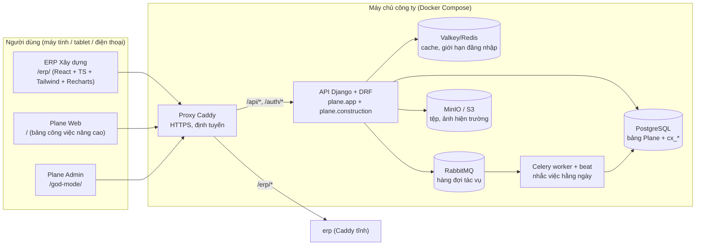

# 2. Kiến trúc hệ thống

## 2.1 Sơ đồ tổng thể



- **Một tên miền duy nhất**: ERP, Plane Web và API cùng nguồn gốc nên dùng chung cookie phiên đăng nhập của Plane; không cần CORS.
- **Không sửa lõi Plane**: phân hệ xây dựng là một Django app riêng (`plane.construction`) với bảng tiền tố `cx_`, đăng ký thêm vào `INSTALLED_APPS`, URL `api/construction/` và lịch Celery. Cập nhật Plane bản mới chỉ cần hợp nhất lại 3 điểm nối này.

## 2.2 Tận dụng Plane như thế nào

| Nhu cầu                                           | Dùng lại của Plane                                                                        | Phần bổ sung                                                                                  |
| ------------------------------------------------- | ----------------------------------------------------------------------------------------- | --------------------------------------------------------------------------------------------- |
| Tài khoản, đăng nhập, phiên, quên mật khẩu, OAuth | `users`, `EmailProvider`, `user_login`, `/accounts/forgot-password`                       | API đăng nhập JSON `/api/construction/auth/login/` (giới hạn 10 lần/phút/IP, kiểm tra Origin) |
| Công ty                                           | `workspaces`, `workspace_members` (admin = quản trị hệ thống)                             | Vai trò nghiệp vụ trong `cx_roles`                                                            |
| Dự án                                             | `projects` (chế độ bí mật), `project_members` (quyền xem theo dự án), trạng thái mặc định | `cx_project_profiles` (mã, chủ đầu tư, địa điểm, loại, ngày, giá trị HĐ, trạng thái)          |
| Công việc / giao việc                             | `issues`, `issue_assignees`, `issue_comments`, `states`                                   | API tiếng Việt, trạng thái đơn giản (Chưa làm / Đang làm / Hoàn thành / Hủy), thông báo       |
| Lưu trữ tệp                                       | `S3Storage` (MinIO/S3), giới hạn dung lượng                                               | `cx_attachments`, tải lên qua API (kiểm tra quyền trước), hỗ trợ lưu cục bộ                   |
| Hàng đợi, lịch                                    | Celery + django-celery-beat                                                               | `construction_daily_reminders`                                                                |

Công việc tạo ở ERP hiện trong Plane Web (Kanban, danh sách, lịch...) và ngược lại - một nguồn dữ liệu duy nhất.

## 2.3 Cấu trúc mã nguồn backend

```
apps/api/plane/construction/
├── models.py            # 25 bảng cx_*
├── permissions.py       # danh mục quyền, vai trò mặc định, AccessContext, ConstructionPermission
├── serializers.py       # kiểm tra dữ liệu đầu vào (ngày, cấp WBS, thành viên dự án, trùng mã...)
├── services/
│   ├── approvals.py     # máy luồng phê duyệt
│   ├── progress.py      # % kế hoạch / thực tế, cộng dồn WBS, xác định chậm tiến độ
│   ├── audit.py         # nhật ký hoạt động (diff trước/sau)
│   ├── notifications.py # thông báo trong ứng dụng (chống trùng)
│   ├── files.py         # lưu tệp S3 / cục bộ, kiểm tra định dạng
│   ├── projects.py      # tạo dự án Plane + thành viên + trạng thái
│   ├── setup.py         # nạp danh mục mặc định (an toàn cho môi trường thật)
│   └── sequences.py     # đánh số phiếu PD-2026-0001 (khóa hàng)
├── views/               # API REST theo phân hệ
├── exports.py           # xuất Excel (chống chèn công thức)
├── tasks.py             # nhắc việc hằng ngày (Celery)
└── management/commands/ # construction_setup, construction_seed_demo
```

## 2.4 API

Tiền tố: `/api/construction/workspaces/<slug>/`. Tất cả danh sách hỗ trợ `q` (tìm kiếm), lọc theo trường, `page`, `page_size` (≤200), `ordering`, và `export=xlsx`.

| Nhóm                 | Endpoint                                                                                    |
| -------------------- | ------------------------------------------------------------------------------------------- |
| Phiên                | `POST /api/construction/auth/login/`, `POST /auth/logout/`, `GET /api/construction/me/`     |
| Công ty              | `context/`, `setup/`, `users/`, `permissions/`, `search/`                                   |
| Điều hành            | `dashboard/`, `reports/{project-summary,progress,hr-efficiency}/`                           |
| Dự án                | `projects/`, `projects/{id}/members/`, `members/add/`, `members/remove/`                    |
| Tiến độ              | `schedule-items/`, `dependencies/`, `milestones/`, `work-logs/`                             |
| Hiện trường          | `daily-reports/` (+ `submit/`, `approve/`, `reject/`)                                       |
| Công việc            | `tasks/`, `tasks/{id}/comments/`                                                            |
| Nhân sự              | `employees/` (+ `create-account/`, `reset-password/`, `photo/`), `departments/`, `roles/`   |
| Mua sắm, thầu, hồ sơ | `suppliers/`, `materials/`, `tenders/`, `tender-items/`, `documents/` (+ duyệt)             |
| Tệp                  | `attachments/` (multipart), `attachments/{id}/download/`                                    |
| Phê duyệt            | `approval-workflows/`, `approval-requests/` (+ `submit/`, `approve/`, `reject/`, `cancel/`) |
| Khác                 | `notifications/` (+ `read/`, `read-all/`, `unread-count/`), `audit-logs/` (chỉ đọc)         |

## 2.5 Xử lý lỗi

- Lỗi kiểm tra dữ liệu trả `400` kèm thông báo tiếng Việt theo từng trường; giao diện hiển thị dưới ô nhập.
- Không có quyền: `403`; dữ liệu của dự án không được tham gia: `404` (không lộ sự tồn tại).
- Dữ liệu đã khóa: `409`.
- Trùng dữ liệu do ghi đồng thời: bắt `IntegrityError` → `400` "Dữ liệu bị trùng lặp".
- Lỗi máy chủ được ghi log JSON (cơ chế log của Plane).
