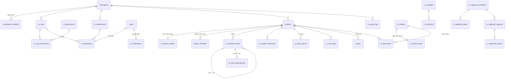

# 3. Thiết kế cơ sở dữ liệu

PostgreSQL. Mọi bảng `cx_*` có khóa chính UUID, `created_at`, `updated_at`, `created_by`, `updated_by`, `deleted_at` (xóa mềm) - trừ các bảng chỉ ghi thêm (nhật ký, lịch sử duyệt, thông báo). Ràng buộc duy nhất chỉ tính các bản ghi chưa xóa (`WHERE deleted_at IS NULL`).

## 3.1 Đối chiếu danh sách bảng yêu cầu

| Bảng theo yêu cầu                                                                               | Bảng thực tế                                                                | Trạng thái  |
| ----------------------------------------------------------------------------------------------- | --------------------------------------------------------------------------- | ----------- |
| users                                                                                           | `users` (Plane)                                                             | ✅ dùng lại |
| roles                                                                                           | `cx_roles`                                                                  | ✅          |
| permissions                                                                                     | `cx_permissions`, `cx_role_permissions`                                     | ✅          |
| departments                                                                                     | `cx_departments`                                                            | ✅          |
| employees                                                                                       | `cx_employees`                                                              | ✅          |
| projects                                                                                        | `projects` (Plane) + `cx_project_profiles`                                  | ✅          |
| project_members                                                                                 | `project_members` (Plane)                                                   | ✅ dùng lại |
| project_tasks                                                                                   | `cx_schedule_items` (WBS) + `issues` (Plane, giao việc)                     | ✅          |
| task_dependencies                                                                               | `cx_task_dependencies`                                                      | ✅          |
| project_milestones                                                                              | `cx_project_milestones`                                                     | ✅          |
| daily_reports                                                                                   | `cx_daily_reports`                                                          | ✅          |
| work_logs                                                                                       | `cx_work_logs`                                                              | ✅          |
| materials                                                                                       | `cx_materials`                                                              | ✅          |
| suppliers                                                                                       | `cx_suppliers`                                                              | ✅          |
| purchase_requests                                                                               | `cx_approval_requests` (loại `purchase`, dòng vật tư trong `details.lines`) | 🟡          |
| documents                                                                                       | `cx_documents` + `cx_attachments`                                           | ✅          |
| notifications                                                                                   | `cx_notifications`                                                          | ✅          |
| approval_requests                                                                               | `cx_approval_requests`, `cx_approval_workflows`, `cx_approval_steps`        | ✅          |
| approval_history                                                                                | `cx_approval_history`                                                       | ✅          |
| audit_logs                                                                                      | `cx_audit_logs`                                                             | ✅          |
| (đấu thầu)                                                                                      | `cx_tenders`, `cx_tender_items`                                             | ✅ bổ sung  |
| (đánh số phiếu)                                                                                 | `cx_sequences`                                                              | ✅ bổ sung  |
| warehouses, inventory_transactions, purchase_orders                                             | -                                                                           | ⏳ GĐ3      |
| budgets, project_costs, revenues, contracts, contract_payments, invoices, receivables, payables | -                                                                           | ⏳ GĐ4      |
| quality_inspections, acceptance_records                                                         | (tạm dùng `cx_documents` loại QA/QC, nghiệm thu)                            | ⏳ GĐ5      |

## 3.2 Sơ đồ quan hệ (ERD rút gọn)

`cx_attachments` liên kết đa hình (`entity_type`, `entity_id`) tới nhân sự, nhật ký, hồ sơ, công việc, hạng mục tiến độ, gói thầu, yêu cầu phê duyệt.

## 3.3 Các bảng chính

### cx_project_profiles

| Cột                                                | Kiểu                 | Ghi chú                                                       |
| -------------------------------------------------- | -------------------- | ------------------------------------------------------------- |
| project_id                                         | UUID, 1-1 `projects` | tên công trình nằm ở `projects.name` (duy nhất trong công ty) |
| code                                               | varchar(32)          | **duy nhất** trong công ty                                    |
| investor, location, project_type                   |                      | chủ đầu tư, địa điểm, loại                                    |
| start_date, planned_end_date, actual_end_date      | date                 | CHECK ngày kết thúc ≥ bắt đầu ở API                           |
| manager_id → users, department_id → cx_departments |                      | người phụ trách, phòng ban                                    |
| status                                             | enum                 | in_progress, paused, delayed, awaiting_acceptance, completed  |
| contract_value                                     | numeric(18,0)        | ≥ 0                                                           |

### cx_schedule_items (WBS)

| Cột                                          | Ghi chú                                                                               |
| -------------------------------------------- | ------------------------------------------------------------------------------------- |
| project_id, parent_id (tự tham chiếu), level | category (Hạng mục) → task (Công việc) → activity (Công tác chi tiết), kiểm tra ở API |
| code                                         | duy nhất trong dự án                                                                  |
| assignee_id                                  | phải là thành viên dự án                                                              |
| start_date, end_date, duration_days          | CHECK `end_date >= start_date`; số ngày tự tính                                       |
| progress (0-100), weight                     | % cấp cha = trung bình có trọng số của cấp con                                        |
| priority, status, note, completed_at         | 100% ⇒ tự chuyển Hoàn thành                                                           |

### cx_approval_requests

| Cột                                               | Ghi chú                                                                                            |
| ------------------------------------------------- | -------------------------------------------------------------------------------------------------- |
| code                                              | `PD-YYYY-NNNN`, duy nhất, đánh số bằng `cx_sequences` có khóa hàng                                 |
| request_type, workflow_id, project_id             |                                                                                                    |
| amount, details (JSON: dòng vật tư, ngày nghỉ...) | tổng tiền tự tính từ dòng vật tư                                                                   |
| requester_id, status, current_step_id             | draft → pending → approved / rejected / cancelled                                                  |
| step_plan (JSON)                                  | danh sách bước áp dụng, **đóng băng lúc gửi** - đổi cấu hình luồng không ảnh hưởng phiếu đang chạy |

### cx_audit_logs (chỉ ghi thêm)

`actor_id, action, entity_type, entity_id, entity_label, project_id, changes (JSON {trường: {old, new}}), ip_address, user_agent, created_at`. Không có API sửa/xóa.

### cx_notifications

`recipient_id, type, title, message, entity_type, entity_id, link, dedup_key, read_at`. Ràng buộc duy nhất `(recipient, dedup_key)` để nhắc việc hằng ngày không gửi trùng.

## 3.4 Chỉ mục

- `cx_attachments(entity_type, entity_id)`, `cx_audit_logs(workspace, entity_type, entity_id)`, `cx_audit_logs(created_at)`, `cx_notifications(recipient, workspace, read_at)`; các khóa ngoại đều có chỉ mục.

## 3.5 Migration

`apps/api/plane/construction/migrations/0001_initial.py` (cấu trúc) và `0002_seed_permissions.py` (danh mục quyền). Chạy cùng `python manage.py migrate` của Plane.
