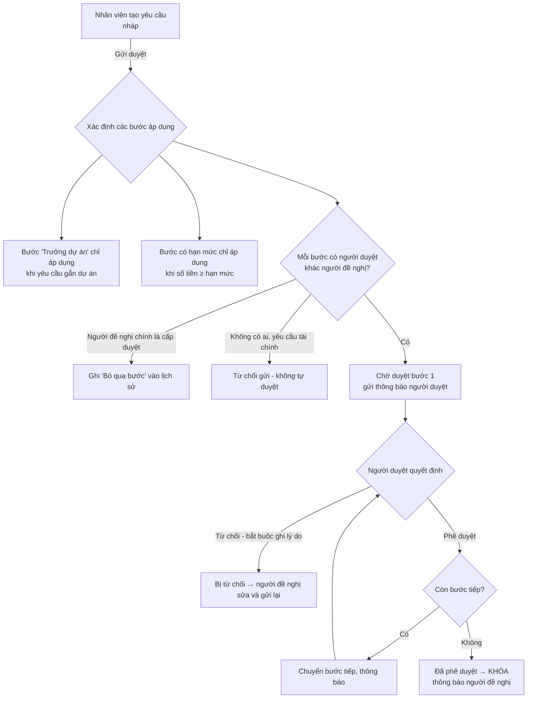
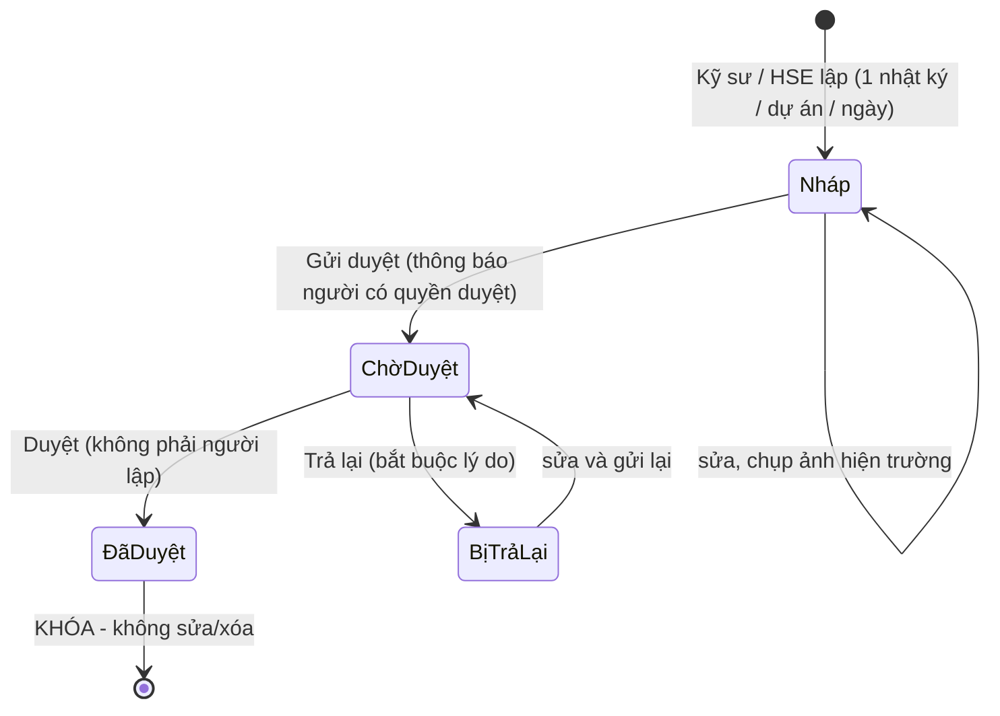
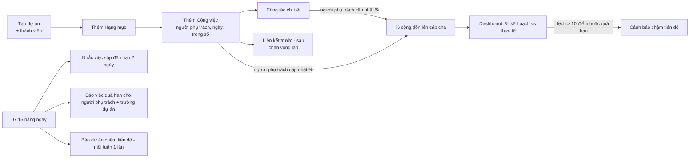
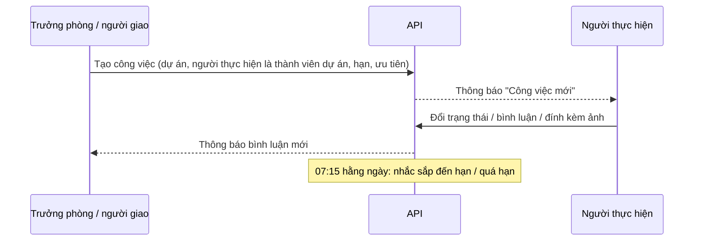

# 4. Luồng nghiệp vụ

## 4.1 Phê duyệt (mua vật tư, thanh toán, tạm ứng, phát sinh, điều chỉnh ngân sách, hợp đồng, nghỉ phép)

Luồng mặc định cho yêu cầu tài chính (chỉnh được ở _Cài đặt → Luồng phê duyệt_):

1. Trưởng bộ phận của người đề nghị kiểm tra
2. Trưởng dự án xác nhận (nếu gắn dự án)
3. Kế toán kiểm tra ngân sách - **bắt buộc ghi ý kiến**
4. Giám đốc phê duyệt khi số tiền ≥ 50.000.000 đ (hợp đồng và điều chỉnh ngân sách: luôn qua Giám đốc)

Nghỉ phép: Trưởng bộ phận duyệt → Nhân sự ghi nhận.

Mọi hành động lưu vào `cx_approval_history` và nhật ký hoạt động.

## 4.2 Nhật ký công trường

Hồ sơ kỹ thuật / nghiệm thu đi cùng quy trình (bắt buộc có tệp đính kèm trước khi gửi; người duyệt nhận thông báo "Hồ sơ cần nghiệm thu").

## 4.3 Lập và theo dõi tiến độ

% kế hoạch tại ngày D của một công việc = số ngày đã trôi qua / tổng số ngày (giới hạn 0-100%); % dự án = trung bình có trọng số của các công việc lá.

## 4.4 Giao việc

## 4.5 Đấu thầu

Tạo gói thầu (hạn nộp, bên mời thầu, người phụ trách) → lập danh sách đầu mục hồ sơ (pháp lý, kỹ thuật, tài chính) giao cho từng người, có hạn → cập nhật trạng thái từng đầu mục → tải tệp hồ sơ → cập nhật kết quả (trúng / trượt) → khi trúng thầu: gắn với dự án mới tạo. Dashboard hiển thị các gói sắp đến hạn nộp trong 14 ngày.
